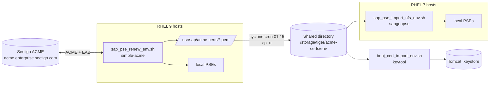

# Automated certificate renewal for SAP (PSE files and BOBJ Tomcat)

Automation that keeps the wildcard TLS certificates of the TIGER SAP landscapes
(sandbox, development, QA, production, training) current without manual work.

* The certificate is requested from **Sectigo** over **ACME** by **simple-acme**.
* The PEM files are written to a shared directory.
* Every SAP host replaces the *own certificate* of its **PSE** files and keeps
  the **PK list** (trusted certificates) of those PSEs intact, using `sapgenpse`.
* BusinessObjects (BOBJ) Tomcat keystores are updated with `keytool`.

> **Status:** the PSE import script (`sap_pse_import_nfs_*.sh`) has been run
> against real PSEs in the sandbox. The PK-list handling was developed against
> real `sapgenpse` output captured in that environment. See
> [Known limitations](#known-limitations) before relying on any script that is
> not mentioned in that section.

## Documentation map

| Document | Read it when you need to... |
|---|---|
| [docs/architecture.md](docs/architecture.md) | understand the moving parts, schedule, hosts, file layout |
| [docs/renew-script.md](docs/renew-script.md) | understand or change `sap_pse_renew_*.sh` (ACME download) |
| [docs/import-script.md](docs/import-script.md) | understand or change `sap_pse_import_nfs_*.sh` (PSE update) - **the most detailed page** |
| [docs/bobj-tomcat.md](docs/bobj-tomcat.md) | understand or change `bobj_cert_import_*.sh` |
| [docs/runbook.md](docs/runbook.md) | set up a new host or landscape, run, verify, roll back |
| [docs/troubleshooting.md](docs/troubleshooting.md) | decode a log message or a failed run |
| [docs/security.md](docs/security.md) | handle credentials, file permissions, publishing this repo |

## What runs where

| Script | Purpose | Runs on | As user | Schedule |
|---|---|---|---|---|
| `install_simple_acme.sh` | installs simple-acme under `/opt/simple-acme` | each host that can run simple-acme (RHEL 9) | root (via Ansible) | once |
| `sap_pse_renew_<env>.sh` | requests/renews the certificate, writes PEMs to `/usr/sap/acme-certs`, updates local PSEs | RHEL 9 hosts | `<sid>adm` | 01:00 daily |
| (cron, no script) | copies the PEMs to the shared directory | 3 RHEL 9 hosts per landscape | `cyclone` | 01:15 daily |
| `sap_pse_import_nfs_<env>.sh` | updates local PSEs from the shared PEMs | RHEL 7 hosts (cannot run simple-acme) | `<sid>adm` | 01:30 daily |
| `bobj_cert_import_<env>.sh` | updates the BOBJ Tomcat keystore from the shared PEMs | BOBJ hosts | `<sid>adm` via `cyclone` cron + sudo | 02:00 daily |

`<env>` is one of `sbx`, `dev`, `qa`, `prod`, `train`. The scripts of one kind are
identical except for the certificate name and the share directory (see
[Environments](#environments)).

## Architecture in one picture



## Daily timeline

| Time | What happens |
|---|---|
| 01:00 | RHEL 9 hosts: `sap_pse_renew_<env>.sh` runs simple-acme; if a new certificate arrived, local PSEs are updated |
| 01:15 | `cyclone` copies new PEM files to the shared directory |
| 01:30 | RHEL 7 hosts: `sap_pse_import_nfs_<env>.sh` updates PSEs from the shared directory |
| 02:00 | BOBJ hosts: `bobj_cert_import_<env>.sh` updates the Tomcat keystore |

Nothing restarts automatically unless `RESTART_ICM=1` is set. A new certificate is
only served after the ICM soft exit (PSEs) or the Tomcat restart (BOBJ). See
[docs/runbook.md](docs/runbook.md#activating-the-new-certificate).

## Environments

| Env | Certificate CN | Shared directory | Notes |
|---|---|---|---|
| `sbx` | `*.sandbox.tiger.edu` | `/storage/tiger/acme-certs/sbx` | |
| `dev` | `*.dev.tiger.edu` | `/storage/tiger/acme-certs/dev` | |
| `qa` | `*.qa.tiger.edu` | `/storage/tiger/acme-certs/qa` | |
| `prod` | `*.tiger.edu` | `/storage/tiger/acme-certs/prod` | parent zone of the other environments, see [CN matching](docs/import-script.md#cn-matching-and-the-prod-script) |
| `train` | `*.training.tiger.edu` | `/storage/tiger/acme-certs/train` | on the on-prem NFS share; all hosts RHEL 9, so no copy job is needed |

## SAP system types

| System type | How the certificate is updated |
|---|---|
| ABAP / Java application servers (PSE files) | automatic: renew script (RHEL 9) or import script (RHEL 7) |
| BusinessObjects Tomcat | automatic keystore update, **manual Tomcat restart** |
| Enterprise Portal | manual: import the PKCS#12 in NWA > SSL Configuration, choose "restart ICM" |
| Content Server | **manual service restart** to load the renewed certificate (`tiger service restart`) |

## Key design decisions

1. **`<sid>adm` runs everything.** PSE files and their SSO credentials (`cred_v2`)
   belong to that user. The scripts refuse to run as root.
2. **SID comes from the hostname** (first three characters). Instances are found by
   which `/usr/sap/<SID>/<NODE>/sec` directories exist.
3. **Only PSEs whose own certificate has the wildcard CN are touched.** All other
   PSEs in the same `sec` directory are skipped.
4. **The PSE update is built aside and swapped in.** The new PSE is written to a
   temporary file, verified, and only then moved over the original. Any failure
   leaves the original untouched.
5. **The PK list is preserved, and verification is by SHA1 fingerprint**, never by
   CN, because several different certificates in one PK list can share a CN.
6. **Everything is backed up first**, including a PEM archive of the complete
   original PK list.

## Known limitations

* **The renew script does not preserve PK lists.** `sap_pse_renew_<env>.sh` still
  recreates PSEs with the older method (`rm` + `import_p8`). A recreated PSE starts
  with only the chain from the new certificate. Entries such as partner or SNC
  certificates are lost on every host where that step runs. It also makes the
  import script skip the PSE later (serial already current), so the loss is not
  repaired. Recommended fix: make the renew script download-only and let the import
  script do all PSE updates (set `CERTS_DIR=/usr/sap/acme-certs` on RHEL 9 hosts).
  Details: [docs/renew-script.md](docs/renew-script.md#known-gap-pk-list-handling).
* **Second BOBJ cluster nodes need checking.** The BOBJ scripts derive the user and
  SSL path from the hostname prefix; on nodes whose SID differs from that prefix
  (`jq2adm`, `jp2adm`) this may not match. See
  [docs/bobj-tomcat.md](docs/bobj-tomcat.md#second-cluster-nodes-verify).
* **Expired PK-list entries are not carried over.** `sapgenpse` accepts them without
  keeping them. They are archived as PEM in the backup directory.
* **The "already current" shortcut compares only the own certificate's serial.** A
  PSE with the right certificate but an incomplete PK list is not repaired unless
  you run `--force`.
* **Output-format dependency.** The import script parses `sapgenpse maintain_pk -l`
  and `get_my_name` text output. A kernel update that changes that text needs a
  review of `pk_entries`, `verify_own` and the expiry parsing.

## Repository layout (suggested)

```
.
├── README.md
├── docs/
├── scripts/
│   ├── install_simple_acme.sh
│   ├── sap_pse_renew_{sbx,dev,qa,prod,train}.sh
│   ├── sap_pse_import_nfs_{sbx,dev,qa,prod,train}.sh
│   └── bobj_cert_import_{sbx,dev,qa,prod}.sh   # remove KS_PASS first, see docs/security.md
└── ansible/
    └── sap_pse_renew_using_ansible.md          # remove EAB credentials first, see docs/security.md
```
