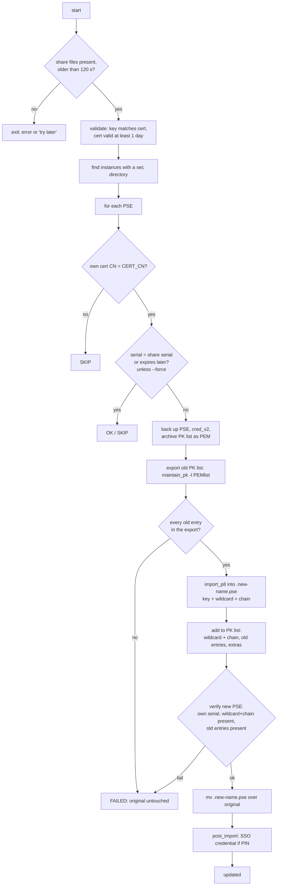

# `sap_pse_import_nfs_<env>.sh` - PSE update from the shared PEM files

The most detailed page. Everything a maintainer needs to understand, test, and
change the script is here.

**Purpose:** on hosts that cannot run simple-acme (RHEL 7), replace the own
certificate (and key) of every PSE that holds the environment's wildcard
certificate with the new one from the shared directory, **adding the new
certificate and its chain to the PK list while keeping every existing PK list
entry**. Nothing is requested from a CA.

* Requires: bash 4.2, OpenSSL 1.0.2 (RHEL 7), `sapgenpse` from the SAP kernel.
* Run as `<sid>adm`; refuses to run as root.
* The five scripts (`sbx`, `dev`, `qa`, `prod`, `train`) are identical except for two
  lines, `CERT_CN` and `CERTS_DIR` (see [Maintaining the five copies](#maintaining-the-five-copies)).

## Usage

```
sap_pse_import_nfs_<env>.sh            # update PSEs whose certificate is older than the share's
sap_pse_import_nfs_<env>.sh --dry-run  # show what would happen, change nothing
sap_pse_import_nfs_<env>.sh --force    # rebuild every matching PSE even if it is current
```

Useful overrides: `NODES=D00` (one instance), `RESTART_ICM=1`, `CERTS_DIR=...`,
`PK_PRESERVE_STRICT=0` (see below).

Exit codes: `0` ok or nothing to do, `1` fatal error, `2` at least one PSE failed.

## Inputs on the share (`CERTS_DIR`)

| File | Required | Content |
|---|---|---|
| `_.<zone>-crt.pem` | yes | wildcard certificate |
| `_.<zone>-key.pem` | yes | private key (convert to PKCS#8 in a temporary file mode 600) |
| `_.<zone>-chain-only.pem` | yes | intermediates |
| `usertrust.pem` | `EXTRA_CA_FILE`, set `""` to disable | USERTrust root missing from Sectigo's served chain |
| `pk-extra-ca.pem` | optional (`TRUST_BUNDLE`) | extra certificates to add to every PK list |
| `pk-extra/*.pem, *.crt, *.cer` | optional (`PK_EXTRA_DIR`) | same, one or more certificates per file, PEM or DER |

## Configuration

| Variable | Default | Meaning |
|---|---|---|
| `CERT_CN` | per environment | CN of the certificate; PSEs whose own certificate has a different CN are skipped |
| `CERTS_DIR` | per environment | share directory |
| `PEM_PREFIX`, `CRT`, `KEY`, `CHAIN` | derived from `CERT_CN` | file names (`*` becomes `_`) |
| `EXTRA_CA_FILE` | `$CERTS_DIR/usertrust.pem` | appended to the chain used for `import_p8` and added to the PK list |
| `MIN_AGE_SECONDS` | `120` | if a share file changed more recently the run exits `0` (file may still be copying) |
| `SAP_BASE` | `/usr/sap` | |
| `PSE_PIN` | empty | PIN for PSEs; empty means PIN-less |
| `TRUST_BUNDLE` | `$CERTS_DIR/pk-extra-ca.pem` | used if the file exists |
| `PK_EXTRA_DIR` | `$CERTS_DIR/pk-extra` | used if the directory exists |
| `RESTART_ICM` | `0` | `1` soft-exits the ICM of an updated instance |
| `BACKUP_KEEP` | `5` | `backup-*` directories kept per instance |
| `PKLIST_STRICT` | `1` | `1`: wildcard or chain missing from the new PK list fails the PSE; `0`: warn only |
| `PK_PRESERVE_STRICT` | `1` | `1`: losing an old PK entry, or failing to export it, fails the PSE (original untouched); `0`: warn only and update anyway |
| `PK_PRESERVE_IGNORE_EXPIRED` | `1` | `1`: expired old entries need not survive (see [expired certificates](#expired-certificates)) |
| `NODES`, `HOST_SHORT`, `SAPGENPSE` | derived | `SAPGENPSE` search order: variable, `/usr/sap/<SID>/<NODE>/exe/sapgenpse`, `/usr/sap/<SID>/SYS/exe/run/sapgenpse`, `PATH` |

## Overview of one run



## Step by step

### 1. Start-up and share validation

* Not root; `openssl` present.
* **Lock:** `flock` on `/tmp/sap_pse_import.<user>.lock`. A second instance exits with an error.
* The certificate, key and chain must exist and be non-empty.
* **Freshness:** each file must be at least `MIN_AGE_SECONDS` old, otherwise the run
  exits `0` with "may still be copied" (the copy job at 01:15 may be mid-write).
* Warning if the key file is readable by *other* (the script cannot fix it).
* Key and certificate must have the same public key (`sha256` of the public key).
* Certificate must be valid for at least one more day.
* The certificate's serial (normalised: no colons, upper case, no leading zeros) and
  expiry are recorded; they decide which PSEs need work.

### 2. Instance discovery

`SID` is the first three characters of `hostname -s`, upper case. Candidate nodes
are `ASCS01 ERS01 C00 C01 D00 J00 SUM W00` plus `D<NN>` from names like `eq1-d02`.
Only nodes with an existing `/usr/sap/<SID>/<NODE>/sec` directory are processed. If
none exists the script aborts.

### 3. Material preparation (once per run)

* the key is converted to PKCS#8 in a mode-600 temporary file;
* `FULLCHAIN` = wildcard, then chain, then `EXTRA_CA_FILE`. `import_p8` validates the
  chain of the certificate it receives, so the intermediates must be supplied;
* **`PK_FILES`**: the wildcard and each chain certificate as separate files, in this
  order. These are inserted into every PK list;
* **`EXTRA_FILES`**: every certificate from `TRUST_BUNDLE` and `PK_EXTRA_DIR`, split
  into single-certificate files (DER files are converted).

Temporary files are removed on exit (`cleanup`, trap on `EXIT`), including a
half-built `.new-*.pse`.

### 4. Per-PSE decision

For each `*.pse` in a `sec` directory, `sapgenpse get_my_name` is read:

| Result | Action |
|---|---|
| own certificate CN is not `CERT_CN` (or the PSE cannot be opened) | `SKIP`, the first `CN=` line or error text is logged |
| serial equals the share's serial | `OK ... already holds the share's certificate` |
| expiry cannot be read | `WARN ... skipping` (use `--force`) |
| PSE expires later than the share's certificate | `SKIP ... expires later` |
| `--dry-run` | `DRYRUN ... would be updated`, no change |
| otherwise (or `--force`) | update |

PSEs that need a PIN or SSO credential which the user does not have (for example
`sap_system_pki_instance.pse`) fail to open and are therefore skipped.

### 5. Update of one PSE

1. **Backup.** Once per instance and run, `sec/backup/backup-MMDDYY-HHMMSS/` is
   created and `cred_v2` copied into it. Each PSE about to change is copied there
   too (with its `<name>.cred_v2` if it exists). A failed backup aborts the script.
2. **Read the original PK list** with `maintain_pk -l`; the entries are parsed into
   SHA1 fingerprint, expiry and subject (`pk_entries`).
3. **Export the original PK list** as PEM with `maintain_pk -l PEMlist`
   (`export_pklist_certs`, both output streams captured), one file per certificate.
   The complete export is saved as `<backup-dir>/<name-without-.pse>.pklist.pem`.
   Every fingerprint of the old list must appear in the export. If one is missing
   and `PK_PRESERVE_STRICT=1`, the PSE is not touched.
4. **Create the new PSE** `sec/.new-<name>` with
   `import_p8 -p <new> -x "$PSE_PIN" -c FULLCHAIN <key.p8>`. Passing `-x ""` makes a
   PIN-less PSE without a prompt. This sets the own certificate and puts the chain in
   the PK list.
5. **Fill the PK list** with `add_pem_to_pklist`, in this order: the wildcard and
   its chain, every certificate exported from the old list, then the extras.
   For each certificate: skip it if the same SHA1 is already present; otherwise try
   `maintain_pk -a`, then `maintain_pk -m <file> -y`; then check that the fingerprint
   is really in the list. A refusal or a silent non-add is logged and the loop
   continues. A certificate with the same subject as one already present is **not**
   skipped.
6. If the own certificate is still not the new one (`verify_own`), try
   `import_own_cert -c <wildcard> -r <chain>` on the new PSE.
7. **Verify the new PSE** (all must hold; see below).
8. **Install:** the new file gets the original's permissions (`chmod --reference`) and
   is `mv`'d over the original. This is the first change to the original.
9. `post_import`: for PIN-protected PSEs, `seclogin` recreates the SSO credential.
10. If anything after the install fails, the backup is copied back. If anything
    before the install fails, the new PSE is simply deleted and the log says
    `the original PSE is unchanged`.

### 6. Verification of the new PSE

All comparisons use **SHA1 fingerprints**, as printed by `maintain_pk -l`
(`Certificate fingerprint (SHA1)`) and by `openssl x509 -fingerprint -sha1`.

| Check | Function | Failure meaning |
|---|---|---|
| Own certificate serial equals the share's | `verify_own` | `import_p8`/`import_own_cert` did not set the certificate |
| Wildcard and each chain certificate are in the PK list | `verify_pklist` | `maintain_pk` did not keep a certificate; `PKLIST_STRICT=0` downgrades to a warning |
| Every unexpired old entry is in the new PK list | `verify_preserved` | an old entry could not be re-added; `PK_PRESERVE_STRICT=0` downgrades to a warning |

CN matching is deliberately not used. One PK list can hold several different
certificates with one CN (for example two `TIGER Test Certificate` entries, or the
current and a previous wildcard). A CN check cannot tell a lost certificate from a
surviving namesake.

### 7. After the run

* Old `backup-*` directories beyond `BACKUP_KEEP` are deleted per instance.
* For updated instances: with `RESTART_ICM=1` the ICM processes
  (`pgrep -f "icman.*<SID>_<NODE>_"`) get SIGINT, equal to *Exit Soft* in SMICM;
  without it a message tells the admin to do it. `SAPSNCS.pse` is picked up only
  after the affected work processes or the instance restart.
* Summary line: `Done: N updated, M already current, K failed.`

## Function map

| Function | Purpose |
|---|---|
| `log`, `die` | timestamped output with host name; fatal error |
| `norm_serial` | normalises serial numbers for comparison |
| `fp_of`, `subject_of` | SHA1 fingerprint and subject of a PEM file |
| `cleanup` | trap handler removing temporary files and a half-built PSE |
| `pk_entries` | parses `maintain_pk -l` into `SHA1<TAB>NOTAFTER<TAB>subject` lines |
| `export_pklist_certs` | `maintain_pk -l PEMlist` into per-certificate PEM files |
| `add_pem_to_pklist` | inserts one certificate and confirms it stuck |
| `build_pse` | export, create new PSE, fill the PK list, own-certificate fallback |
| `verify_own`, `verify_pklist`, `verify_preserved` | the three checks |
| `install_pse` | permissions and `mv` over the original |
| `post_import` | `seclogin` for PIN-protected PSEs |
| `process_instance` | loop over the PSEs of one instance, backups, pruning, ICM |

## Backups and the PEM archive

```
/usr/sap/<SID>/<NODE>/sec/backup/backup-MMDDYY-HHMMSS/
├── cred_v2                       # shared SSO credential file
├── SAPSSLS.pse                   # copies of each PSE that was replaced
├── SAPSSLS.pklist.pem            # complete PK list of that PSE as PEM, expired entries included
└── ...
```

To restore a PSE manually, see [runbook.md](runbook.md#rolling-back).

## What `sapgenpse` does (observed behaviour)

These facts drove the design. Items marked *documented* are in SAP's help; the others
were **observed in this environment** (kernel `sapgenpse` on RHEL 7, October 2026)
and are not guaranteed by SAP.

| Fact | Consequence |
|---|---|
| `import_p8` creates a PSE; it fails with `PSE ... already exists!` if the file exists (*observed*; SAP describes it as creating a new PSE) | the key cannot be swapped in place; a new PSE file is needed |
| `import_p8` without `-c` fails: `you didn't supply any certificates!` (*observed*) | always pass a certificate |
| `import_p8 -c <leaf only>` fails: `certificate chain is incomplete, need certificate of '<intermediate>'` (*observed*) | `-c` needs the leaf followed by the intermediates |
| a new PSE has an empty PK list apart from what `-c` provides (*observed*) | old entries must be re-added |
| `maintain_pk -a`, `-d`, `-l` add, delete, list (*documented*); `-m <file> -y` bulk-adds and was already used by the original scripts | used for insertion and listing |
| `maintain_pk -l` prints one `Element #N:` block per entry, with `Subject:`, `Validity not after: ... (YYMMDDhhmmssZ)`, `Certificate fingerprint (SHA1):` (*observed*) | parsed by `pk_entries` |
| `maintain_pk -p <pse> -l PEMlist` prints every PK-list certificate as PEM, on stderr (*observed*) | the only way found to read old entries back |
| `maintain_pk -l -v` prints details, not PEM (*observed*) | not usable for export |
| `openssl pkcs12 -in x.pse` fails with ASN.1 errors (*observed*) | PSE files are not readable by openssl |
| `export_p12 -C 0` exports the own certificate with its hierarchy only (*documented*) | does not cover unrelated PK entries; not used |
| `maintain_pk -a` of an **expired** certificate returns success but the certificate is not in the list afterwards (*observed*, inferred from several logs) | expired old entries cannot be carried over |
| a PSE can contain several certificates with the same subject (*observed*) | verification by fingerprint |
| PIN-protected PSEs without SSO credential cannot be opened (`Missing PIN/Passphrase`) (*observed*) | they are skipped |

### Expired certificates

Old PK entries that are already expired (for example a previous wildcard) are not
re-added: `sapgenpse` accepts them silently without keeping them. With the default
`PK_PRESERVE_IGNORE_EXPIRED=1` each is logged as
`expired entry not carried over: SHA1 ..., expired ..., <subject>` and does not fail the
update. They are still in the backup, both in the original PSE and in
`<name>.pklist.pem`. Setting `PK_PRESERVE_IGNORE_EXPIRED=0` makes them count as losses
(which then fail the PSE under `PK_PRESERVE_STRICT=1`); it does not make `sapgenpse`
keep them.

### CN matching and the prod script

The script looks for the text `CN=<CERT_CN>` anywhere in the `get_my_name` output
(case-insensitive, fixed string). For prod that is `CN=*.tiger.edu`, which is not a
substring of `CN=*.dev.tiger.edu` or `CN=*.sandbox.tiger.edu`, because the text
`CN=*.` is followed by the sub-zone name. This works only because `CN=*.` is part of
the match. Do not loosen it (for example to `tiger.edu`). If a host ever carries
PSEs from two environments, run `--dry-run` first.

## Reading the log

| Line | Meaning |
|---|---|
| `Share certificate: serial ..., expires ...` | what the share offers |
| `SID=... INSTANCES=... CN=...` | what the script found on this host |
| `Certificates inserted into each PK list: [...] plus N chain certificate(s)` | wildcard plus chain size (expect 3: two Sectigo certificates and USERTrust) |
| `Extra PK list certificates (from N file(s)): M` | extras found |
| `OK` / `SKIP` / `WARN` / `DRYRUN` | per-PSE decision (see step 4) |
| `PK list of X: N entr(y/ies), M certificate(s) exported with PEMlist` | `M` should be at least `N` |
| `PK list of X: added <subject>` / `already present` | per-certificate result |
| `sapgenpse accepted but did not keep (EXPIRED, ...)` | expired certificate silently refused |
| `expired entry not carried over` | old expired entry, ignored by default |
| `lost a pre-existing entry` | an unexpired old entry is missing from the new PSE; the PSE is not replaced |
| `FAILED ... the new PSE was discarded, the original PSE is unchanged` | a check failed before the install; look at the lines just above |
| `FAILED ... after the new PSE was installed - restoring` | a failure after the swap; the backup was copied back |
| `Done: N updated, M already current, K failed.` | summary |

More in [troubleshooting.md](troubleshooting.md).

## Maintaining the five copies

The five scripts differ only in these two lines:

| Script | `CERT_CN` | `CERTS_DIR` |
|---|---|---|
| `sbx` | `*.sandbox.tiger.edu` | `/storage/tiger/acme-certs/sbx` |
| `dev` | `*.dev.tiger.edu` | `/storage/tiger/acme-certs/dev` |
| `qa` | `*.qa.tiger.edu` | `/storage/tiger/acme-certs/qa` |
| `prod` | `*.tiger.edu` | `/storage/tiger/acme-certs/prod` |
| `train` | `*.training.tiger.edu` | `/storage/tiger/acme-certs/train` |

Edit the sandbox script, test it, and regenerate the others:

```bash
gen() {
  sed -e "s|^CERT_CN=.*|CERT_CN=\"\${CERT_CN:-$2}\"|" \
      -e "s|^CERTS_DIR=.*|CERTS_DIR=\"\${CERTS_DIR:-$3}\"|" \
      sap_pse_import_nfs_sbx.sh > "sap_pse_import_nfs_$1.sh"
  chmod +x "sap_pse_import_nfs_$1.sh"
}
gen train '*.training.tiger.edu' /storage/tiger/acme-certs/train
gen qa    '*.qa.tiger.edu'       /storage/tiger/acme-certs/qa
gen prod  '*.tiger.edu'          /storage/tiger/acme-certs/prod
gen dev   '*.dev.tiger.edu'      /storage/tiger/acme-certs/dev
```

A cleaner long-term layout is one script with an `ENV` argument or an env file; the
five copies exist only for historical reasons.

## Testing changes

1. `bash -n sap_pse_import_nfs_sbx.sh` for syntax.
2. A **stub `sapgenpse`** (a shell script that mimics `get_my_name`, `import_p8`,
   `maintain_pk -l/-a/-m/-l PEMlist`, `import_own_cert`) lets the control flow be
   tested on any machine: set `HOST_SHORT`, `SAP_BASE`, `CERTS_DIR`, `SAPGENPSE`,
   `NODES` and run as a non-root user. The scenarios used during development were:
   normal update; export missing one entry (original must stay unchanged); expired
   entry that `maintain_pk -a` silently refuses; `PK_PRESERVE_STRICT=0`.
   A stub only proves the script's logic, not `sapgenpse` behaviour.
3. On a real host: `--dry-run`, then `NODES=<one instance> ... --force`, then verify
   with the commands in [runbook.md](runbook.md#verifying-a-pse).
4. **Back up the whole `sec` directory yourself** before the first real test.

## Limitations

* Only PSEs whose own certificate has the wildcard CN are handled; everything else
  is left alone.
* PIN-protected PSEs work only if `PSE_PIN` is set; otherwise they cannot be read.
* The order of entries in the PK list is not preserved; the content is.
* `sapgenpse` output text is parsed; see [README](../README.md#known-limitations).
* Entries without a readable PEM export (none seen so far) block the update under
  `PK_PRESERVE_STRICT=1`. Supply the missing PEM in `pk-extra/`, or accept the loss
  with `PK_PRESERVE_STRICT=0` (the backup has it).
* The "already current" shortcut checks the own certificate only; use `--force` to
  repair an incomplete PK list.
